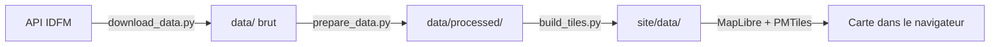
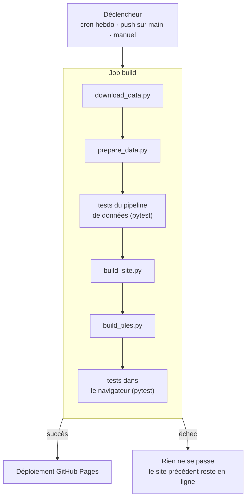

# Le pipeline de données

Ce document décrit le trajet des données, depuis l'API d'Île-de-France Mobilités jusqu'à la carte affichée dans le navigateur, et la façon dont ce trajet est automatisé chaque semaine.

## De la donnée brute au site

- **`data/`** — fichiers bruts tels que fournis par l'API (GeoJSON des lignes, CSV d'accessibilité, etc.).
- **`data/processed/`** — `lines.geojson` et `stops.geojson`, nettoyés et joints (accessibilité par arrêt et par ligne, ville de chaque arrêt, couleurs et modes normalisés).
- **`site/data/`** — `transports.pmtiles` (les géométries, découpées en tuiles vectorielles par niveau de zoom) et `lines.json` (la liste des lignes utilisée par le panneau de filtres : accessibilité de leurs arrêts par ville, et emprise des lignes et des villes pour le zoom).
- Le navigateur ne télécharge jamais l'intégralité de ces fichiers : il ne demande, via `pmtiles.js`, que les tuiles correspondant à la zone et au niveau de zoom affichés.

Ces trois scripts (`download_data.py`, `prepare_data.py`, `build_tiles.py`) peuvent être relancés à la main pour retrouver l'état exact que produit l'automatisation ci-dessous.

## Automatisation hebdomadaire

`build_site.py` (assemblage des pages HTML depuis `site/_pages/` + `site/_partials/`) n'a aucune dépendance sur les données ; il est placé juste avant `build_tiles.py`, avec lequel il forme l'étape d'assemblage de `site/` — les tests dans le navigateur qui suivent (chargement de la page, filtres, popup) vérifient les deux d'un coup.

Le fichier `.github/workflows/build-deploy.yml` exécute cette chaîne chaque lundi à 3h UTC, à chaque `push` sur `main`, et sur déclenchement manuel. Chaque exécution part d'une machine vierge : aucune donnée ne persiste d'une exécution à l'autre, et le site en ligne n'est modifié qu'à la toute dernière étape — jamais avant que tout ait réussi. Un échec à n'importe quelle étape (par exemple si l'API change de format, ou si un arrêt n'a plus de ville, et que `pytest` le détecte) arrête tout sans conséquence : le site continue de servir la version précédente, et les fichiers de données de l'exécution ratée sont conservés 14 jours en pièce jointe du run GitHub Actions, pour pouvoir être inspectés.

## Points d'attention

- **Certains tests avertissent au lieu d'échouer** : quand un changement extérieur demande une correction sans rendre le site faux (nouvelle ligne de métro inconnue des règles d'accessibilité, accessibilité publiée par quai, lien externe cassé), le déploiement a lieu, et le workflow ouvre une issue GitHub (ou commente celle déjà ouverte).
- **On développe sur la branche `dev`** : un push sur `dev` ne déclenche rien ; une pull request de `dev` vers `main` lance la construction et les tests, sans déployer ; c'est la fusion dans `main` qui met le site en ligne.
- **En local, les tests sautent quand leurs fichiers manquent** : « tout passe » peut vouloir dire « rien n'a tourné ». Lancer d'abord le pipeline (`prepare_data.py`, puis `build_tiles.py` pour les tests dans le navigateur).
- **tippecanoe n'est pas un paquet Python** : le workflow le compile (et le met en cache) ; en local, il s'installe à part ([felt/tippecanoe](https://github.com/felt/tippecanoe)), et `build_tiles.py` le cherche dans le `PATH` ou dans `~/.local/bin`.
